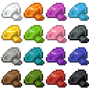
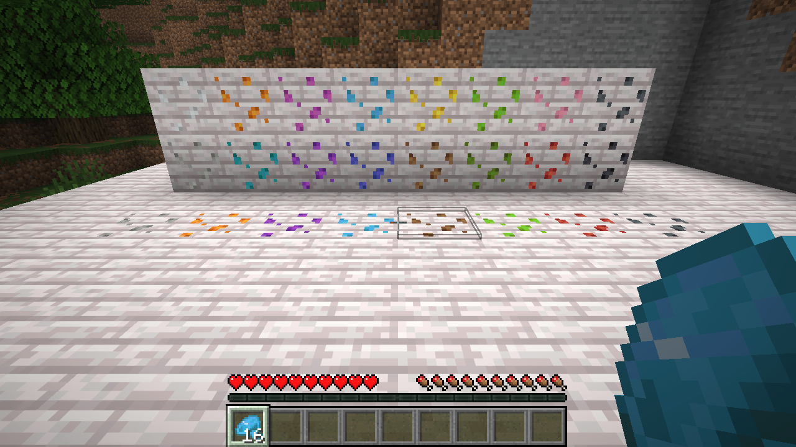
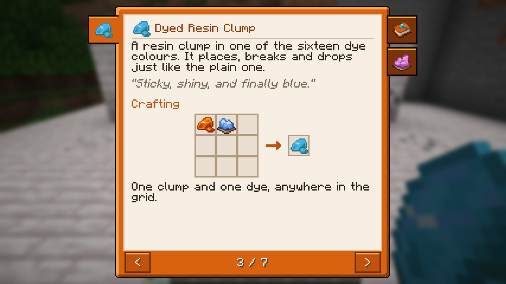

# Dyed Resin



Resin clumps in all sixteen dye colours for Minecraft 26.2 (Fabric). A resin clump and a dye in the crafting grid make
a **Dyed Resin Clump**, and eight clumps around a dye make eight at once. Dyed clumps are placed, broken and dropped
just like plain ones, take any other dye to change colour, and turn plain again when you put one into the crafting
grid on its own. Everything is in its own creative tab, *Dyed Resin*.



## Download

Get `dyedresin-<version>.jar` from [CurseForge](https://www.curseforge.com/minecraft/mc-mods/dyed-resin) or the
[GitHub releases](../../releases) and put it into `mods/` on the client and the server, next to Fabric API. Requires Minecraft 26.2, Fabric Loader 0.19.3+ and Java 25.

## The guide book

Every player gets a **Dyed Resin Guide** the first time they join: a book with the recipes and an overview of the
colours, in English and German. Right-click opens it; the clump's tab is on the left, the topics' on the right. Lost
it? Craft a new one from a book and a resin clump, or take it from the creative tab.

This page follows the book chapter by chapter and adds the details that do not fit on its pages.



<!-- listing:skip -->
| Chapter | |
|---|---|
| [Getting Started](#getting-started) | dye, place, wash out |
| [Dyed Resin Clump](#dyed-resin-clump) | the recipes and how a clump is used |
| [Colours](#colours) | all sixteen clumps |

Not in the book: [Building](#building).
<!-- listing:end -->

## Getting Started

Resin clumps in all sixteen dye colours. Dye a clump in the crafting grid, place it like a plain one, and wash the
colour out again whenever you like.

1. Put a resin clump and a dye into the crafting grid: you get a dyed clump.
2. Place it on any side of a block, like a plain clump.
3. Put a dyed clump into the grid on its own: it turns plain again.

## Dyed Resin Clump

A resin clump in one of the sixteen dye colours. It places, breaks and drops just like the plain one.

> *"Sticky, shiny, and finally blue."*

**Crafting** – one resin clump and one dye, shapeless:

```
R D        R = resin clump (plain or dyed), D = any dye
```

Or eight clumps around a dye for eight dyed clumps:

```
R R R
R D R      R = resin clump (plain or dyed, mixed is fine), D = any dye
R R R
```

**Use**

- Right-click a block to stick the clump to that side. More clumps go onto the other sides of the same spot; breaking
  it drops every clump on it. No tool is needed.
- A dyed clump takes any other dye, so you can change its colour without washing it first.

**Washing out** – a dyed clump alone in the crafting grid gives a plain resin clump back. The dye is used up.

Only plain clumps make resin blocks and resin bricks and serve as an armour trim material: wash a dyed clump out
first.

## Colours

Every dye of the game has its clump: white, orange, magenta, light blue, yellow, lime, pink, gray, light gray, cyan,
purple, blue, brown, green, red and black. On maps each clump shows in its dye's colour.

<!-- listing:skip -->
## Building

Java 25, `./gradlew build` → `build/libs/dyedresin-<version>.jar`. Needs
[bcf-guide-book-lib](https://github.com/david-stefan-hermann/bcf-guide-book-lib) in the local Maven repository first:
`./gradlew publishToMavenLocal` in a checkout of it.

- `tools/make_textures.py` recolours vanilla's resin clump textures (from the loom cache) into the sixteen item and
  block textures; `tools/make_art.py` builds the logo and the guide book's texture from them.
- `tools/make_resources.py` writes the blockstates, models, loot tables, recipes, tags and item names.
- `tools/self-test.sh` starts the dev server, crafts every recipe through the real recipe manager, places and breaks
  clumps, and prints the failed checks (`SELFTEST PASS/FAIL` in `run/selftest.out`).
- `./gradlew runClient -PbookShots` saves every page of the guide book, `./gradlew runClient -PdevScene` the picture
  above; both join the world `run/saves/bookshots`.
- The guide book's content is `src/main/java/dyedresin/GuideBook.java`, its texts are in the language files.
<!-- listing:end -->

## License

MIT, see [LICENSE](LICENSE). By BaconCakeFactory.
